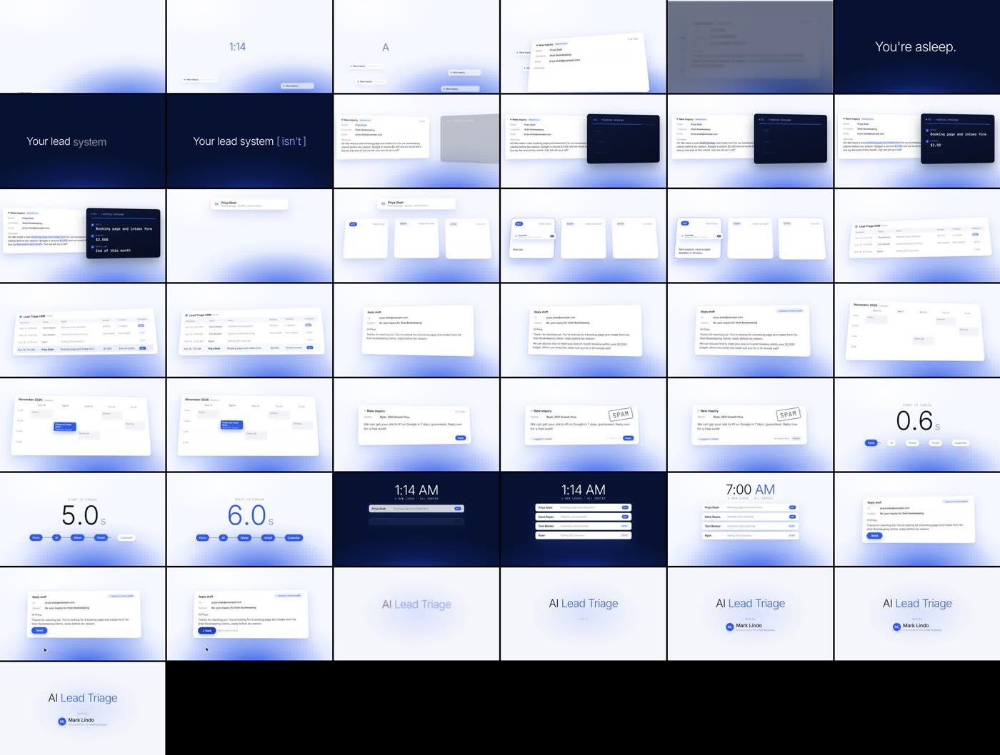
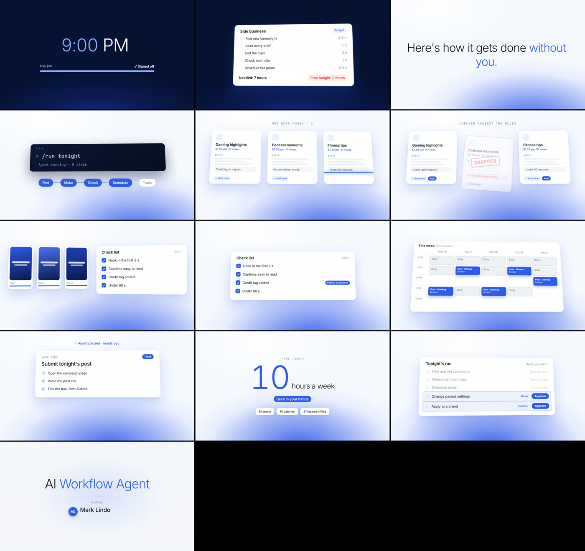
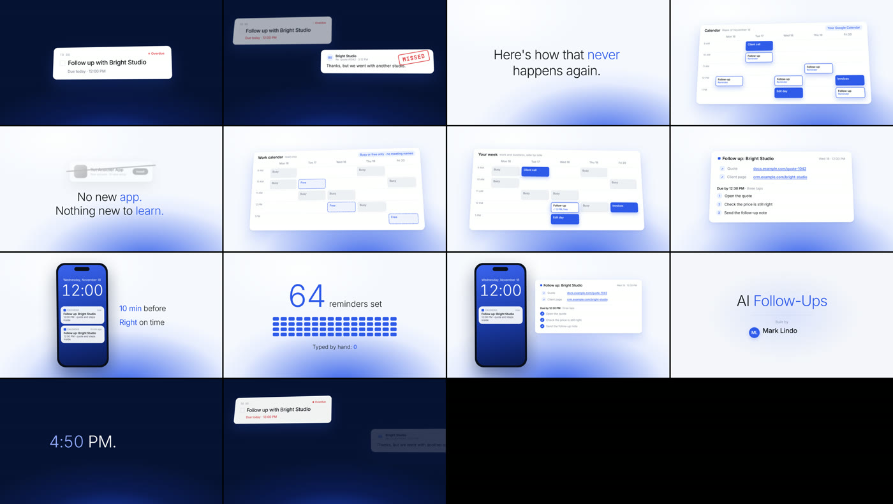

# AI Automation Promo Ads

Three 16:9 promo videos for AI automation services, built in code with [Remotion](https://www.remotion.dev/) (React). Every scene, card, and camera move is a React component, so a client's name, numbers, and brand colors change in one file and the video renders again.

Watch the finished videos on the [Releases page](../../releases).

| Ad | Length | What it shows |
|---|---|---|
| [AI Lead Triage](ads/lead-triage) | 43 s | A form inquiry arrives at 1:14 AM. AI sorts it as hot, warm, or spam, logs it to a sheet, saves a reply as a Gmail draft, and books a follow-up. Includes a 3D opening shot (Three.js). |
| [AI Workflow Agent](ads/agent-workflow) | 49 s | An agent runs a five-step job on one command, checks its own work, and stops for a person only at sign-ins and approvals. |
| [AI Follow-Ups](ads/follow-ups) | 52 s | Follow-up reminders land on the calendar with the links and steps inside, so a quote never goes cold. |

## AI Lead Triage


## AI Workflow Agent


## AI Follow-Ups


## How it is built
- **Remotion 4** with React 19 and TypeScript. One `Ad.tsx` per video holds the scenes; `Brand.tsx` holds colors, fonts, and the end card.
- **Timing from the voiceover.** `src/timing.json` lists when each voice line starts and ends, and every scene keys its animation to those times, so a new voice take re-times the whole video.
- **Motion:** spring animations, cursor moves, typing, stamps, and calendar fills are drawn in code, with no stock templates.
- **3D:** the Lead Triage opening uses `@remotion/three` and React Three Fiber.
- **Demo data only.** Every name, email, and company on screen (Priya Shah, Bright Studio, example.com) is made up.

## Run it
```
cd ads/lead-triage
npm install
npx remotion studio src/index.ts
```

Render the video:
```
npx remotion render src/index.ts Ad out/ad.mp4
```

The voice, music, and sound effect files are not in this repo. To render with sound, add your own WAV files at the paths the code reads: `public/voice/line01.wav` and on, `public/music.wav`, and `public/sfx/*.wav`.

Fonts: Inter and Montserrat, under the SIL Open Font License.

## Contact
Built by Mark Lindo, AI and CRM automation. Hire me on [Upwork](https://www.upwork.com/freelancers/~012555ca2cdbf0753d).
